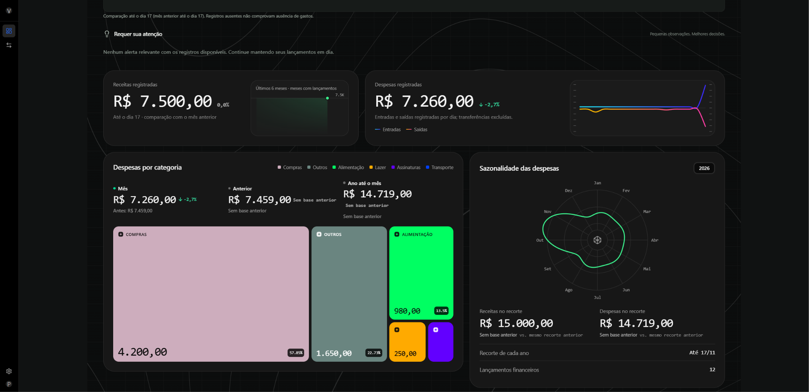
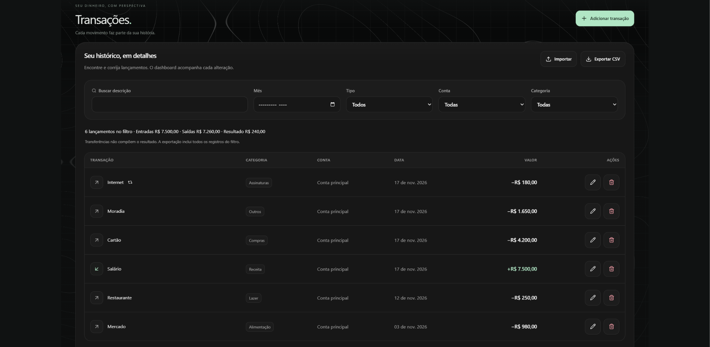

# Vértice Finance

Personal finance dashboard built with **React, TypeScript, Vite and Tailwind CSS** to track income, expenses, transfers, budgets and financial trends.

The project focuses on practical financial management, reliable business rules and a polished responsive interface.

> **Status:** Active development

---

## Preview

### Dashboard



### Transactions



## Tech Stack

**Front-end**
- React 19
- TypeScript
- Vite
- Tailwind CSS
- Framer Motion
- Recharts
- Lucide Icons

**Data & Persistence**
- IndexedDB
- CSV import/export
- XLSX import with ExcelJS

**Testing & Quality**
- Vitest
- Playwright
- TypeScript strict checks
- Prettier

---

## Main Features

- Income, expense and transfer management
- Multiple financial accounts
- Custom categories
- Monthly budgets
- Financial goals
- Monthly performance overview
- Spending trends and category analysis
- Financial alerts and projections
- CSV and XLSX import
- CSV and JSON export
- Responsive interface
- Local data persistence with IndexedDB

---

## Engineering Highlights

### Financial calculations

Financial values are handled using integer cents to reduce floating-point precision problems.

The dashboard includes calculations for:

- monthly net balance
- account balances
- budget utilization
- revenue changes
- spending anomalies
- financial projections

### Smart financial alerts

The application evaluates multiple signals and prioritizes the most relevant alerts, including:

- monthly deficit
- low account balance
- budget limits
- revenue drops
- unusual spending categories
- changes in spending patterns

### Reliable imports

CSV and XLSX files can be mapped and validated before importing.

The import process supports:

- multiple date formats
- decimal separator selection
- column mapping
- duplicate detection
- account/category matching
- atomic imports with rollback on failure

### Local-first architecture

The application currently runs without a backend.

Data is stored with **IndexedDB**, and multiple browser tabs are synchronized using `BroadcastChannel`.

The data-access layer uses a repository abstraction, making it possible to replace IndexedDB with a remote API in the future without moving business logic into UI components.

---

## Testing

The project includes both unit and end-to-end tests.

### Unit tests

Vitest covers:

- financial calculations
- transfers
- budgets
- projections
- alerts
- validation
- import logic
- account rules

### E2E tests

Playwright validates real user flows such as:

- creating income and expenses
- transfers
- editing and deleting transactions
- persistence
- CSV/XLSX imports
- settings
- migrations
- multi-tab synchronization
- responsive layouts
- error handling

Responsive behavior is tested across widths from **320px to 1440px**.

---

## Architecture

```text
src/
├── components/
│   ├── dashboard/
│   ├── transactions/
│   ├── settings/
│   ├── charts/
│   └── ui/
├── features/
│   ├── dashboard/
│   └── transactions/
├── hooks/
├── services/
├── types/
├── data/
└── utils/

tests/
└── Playwright E2E flows
```

The application keeps financial rules separated from presentation components.

---

## Running Locally

```bash
git clone https://github.com/fred-rose/vertice-finance.git
cd vertice-finance

npm install
npm run dev
```

### Build

```bash
npm run build
```

### Unit Tests

```bash
npm test
```

### E2E Tests

```bash
npm run test:e2e
```

---

## Current Limitations

The current version does not include:

- authentication
- cloud synchronization
- bank integrations
- automatic recurring transactions
- a remote backend

Data is stored locally in the browser.

---

## Roadmap

- [ ] Cloud backend and authentication
- [ ] Cross-device synchronization
- [ ] Recurring transactions
- [ ] Dedicated budget and goal pages
- [ ] Full backup restoration
- [ ] OFX import
- [ ] Expanded financial analytics

---

## What I learned

This project helped me improve my skills in:

- React architecture
- TypeScript
- financial business rules
- local-first applications
- IndexedDB
- automated testing
- CSV/XLSX processing
- responsive UI development
- error handling and data validation

---

## Author

**Fred Rose**

ADS student focused on **React, TypeScript, Python and Full-stack development**.

[GitHub](https://github.com/fred-rose)
