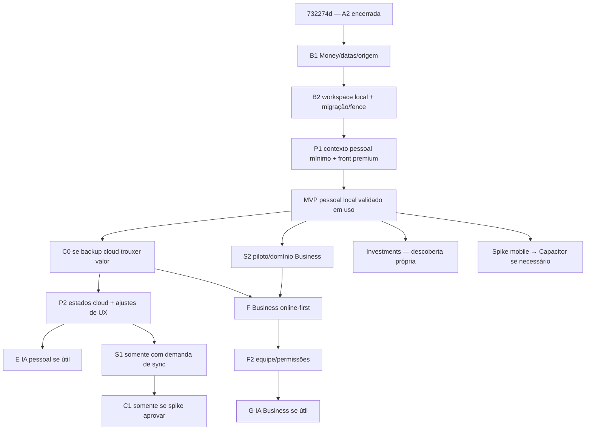

# 1. Estado atual

Revisão oficial pós-A2, em 04/10/2026. Checkpoint confirmado: **`732274d0ed10ff85d7c0717f056c29219d5952d9` — `feat: protege trabalho nao salvo e updates PWA A2c`**. Repositório: `C:\Users\patai\OneDrive\Documentos\Dashboard Financeiro`, pacote `vertice-financeiro`.

| Entrega encerrada | Evidência Git | Resultado consolidado |
| --- | --- | --- |
| A0/A1 | `971f195` | Baseline e restore JSON v2 com prévia, safety, substituição atômica, rollback e verificação posterior; correções R1/R2 fechadas |
| A2a | `7f80ff2` | Leitura estrutural, configurações reais obrigatórias, recovery, ausência de defaults em corrupção, histórico independente do relógio |
| A2b | `7ac117a` | CAS/revisão global local, seis writers protegidos, create/update distintos e fence v2→v3 |
| A2c | `732274d` | Dirty registry síncrono, guards de modal/rota/beforeunload/PWA, revogação da autorização de reload e consulta readonly de sessões invalidadas |

**A série A2 está encerrada.** Não apareceu nesta inspeção um bloqueador novo que justifique reabri-la. Os limites de crash/mobile, corrupção sem backup e compatibilidade de releases continuam explícitos; não equivalem a funcionalidades prometidas e ausentes de A2.

O produto já registra receitas, gastos e transferências, permite editar/excluir, importar CSV/XLSX com revisão, configurar contas/categorias/orçamentos/metas, mostrar resumo/comparação/tendência/alertas e restaurar backup. Funciona localmente e como PWA. É uma base pessoal utilizável; falta consolidar contratos de crescimento e concluir o acabamento como produto. Não existem autenticação, workspace explícito, backend financeiro, sync remoto, IA ou Business.

Persistência atual: IndexedDB **v3**, database `vertice-finance`, stores `transactions` e `settings`. A revisão fica em metadata reservada; **backup financeiro continua JSON v2**. Versão de DB, protocolo CAS e formato de backup são conceitos separados. Drafts vivem somente no documento; não há armazenamento durável adicional de drafts.

## Base de evidência e limites

Prioridade aplicada: [Decisões](DECISOES-VERTICE-2.md) → [Arquitetura revisada](ARQUITETURA-VERTICE-2-REVISADA.md) → [Auditoria](AUDITORIA-ARQUITETURA-VERTICE-2.md) → relatórios A0/A1/A2 → README → código/testes pertinentes. As recomendações abaixo são decisões de roadmap, não implementações.

Referências técnicas principais: [tipos](src/types/finance.ts), [validação/parser](src/features/transactions/validation.ts), [cálculos](src/features/dashboard/calculations.ts), [importação](src/features/transactions/importExport.ts), [backup](src/features/transactions/backup.ts), [repository](src/services/transactionRepository.ts), [hook financeiro](src/hooks/useTransactions.ts), [Overview](src/components/dashboard/OverviewPage.tsx), [A2b](IMPLEMENTACAO-A2B.md) e [A2c](IMPLEMENTACAO-A2C.md).

Na execução imediatamente anterior, a árvore isolada que originou `732274d` passou **246/246 unitários e 227/227 E2E**, incluindo 14 PWA, build, TypeScript aplicação/tests/config, Prettier e staged diff check. O commit foi conferido contra a árvore validada. São evidências dessa execução anterior, **não suítes repetidas nesta revisão documental**. Os 237 E2E do relatório de implementação incluíam dez testes gerais de visual/Three; estes ficaram fora do commit A2c.

O working tree continua misto: README, estilos, componentes, dependências Three, capturas, testes e documentos ainda têm trabalho preexistente fora de commits. [REFINAMENTO-VISUAL.md](REFINAMENTO-VISUAL.md) e [CAMADA-3D.md](CAMADA-3D.md) descrevem acabamento já disponível no workspace, não uma entrega integral presente no checkpoint. Não reiniciar esse trabalho nem presumir que sua integração foi certificada pela validação isolada de A2c.

Informações antigas agora obsoletas: “restore não existe”, “não há CAS”, “DB v2 atual”, “A2c pendente”, “A0/A1 é a próxima entrega” e contagens históricas apresentadas como atuais. Os documentos existentes ficam preservados como histórico; este relatório fornece a leitura pós-A2.

# 2. Roadmap antigo

Sequência histórica aproximada fornecida:

`A0 → A1 → A2 → B1 → B2 → D → S1 → C0 → C1 se provar valor → S2 → E → F → F2 → G → mobile`

As decisões de setembro já permitiam C0 sem C1, Business online-first e D/C0 independentes após fronteiras mínimas. O problema é tratar o desenho como uma fila obrigatória: sync, IA, Business e mobile não são necessários para entregar valor pessoal local.

# 3. O que mudou

| Tratamento | Decisão pós-A2 |
| --- | --- |
| Permanecem | React/TS/Vite/PWA, monólito modular, uma autoridade por modo, Money exato, datas civis/instantes separados, backup verificável, recuperação e CAS |
| Encerradas | A0/A1/A2a/A2b/A2c saem da fila futura; mantêm apenas regressões obrigatórias |
| B1 muda | Fechar lacunas concretas de Money/corte/origem; não repetir parser, conservação de transferências, validação estrutural ou CAS já sólidos |
| B2 permanece | Workspace local obrigatório antes de cloud; proprietário local implícito sem login; migração/fence própria a partir da versão **3** |
| D é reduzida e fundida | Contexto pessoal mínimo entra na passada P1, com um consumidor real: dashboard premium. Sem plataforma de contexto universal |
| Front é dividido | P1 antes de cloud; P2 somente para os estados introduzidos por C0/C1, sem redesenhar tudo |
| S1 muda de lugar | Só antecede C1 quando houver demanda de edição entre dispositivos; não bloqueia C0 nem MVP local |
| C0 muda de condição | Backup cloud opcional após uso pessoal validado; Auth e isolamento entram juntos, não como fase antecipada |
| C1 é adiada | Fora do MVP mínimo; benefício e complexidade precisam ser comprovados |
| S2/F/F2/G viram ramo | Business separado depois do MVP pessoal, condicionado a piloto e contratos próprios |
| E é adiada | Depois de P1 e da fundação C0, se perguntas reais justificarem o custo; não depende de C1 |
| Investments/mobile | Posteriores ao MVP, conforme demanda e ensaios; sem contaminar Personal |
| Removido do caminho obrigatório | Sync completo, billing genérico, catálogo amplo de métricas, vários agentes, múltiplos conectores e arquitetura de grande escala |

Não foram removidos gates de integridade. Foram removidas dependências sem consumidor atual.

## Lacunas exatas de B1

| Tema | Estado real | Decisão executável |
| --- | --- | --- |
| Conservação e soma em centavos | JÁ RESOLVIDO no fluxo ordinário: transferências não contam como receita/despesa; somas convertem `amount * 100` | Preservar fórmulas e testes de paridade |
| Money canônico | PARCIAL: `amount`, saldos, metas e limites persistem em reais `number`; não existe contrato `Money` compartilhado | Domínio em centavos BRL com validação runtime e adapters explícitos para o legado |
| Number e acumuladores | AINDA NECESSÁRIO: teto por linha existe, mas somas/produtos em `calculations.ts` não checam todos os intermediários | Checked add/multiply/rounding; valor fora da faixa retorna erro/indisponibilidade identificada, nunca aproximação silenciosa. BigInt somente onde provar necessidade, sem troca geral |
| Parsing | PARCIAL: regex localizada, finitude e duas casas já existem; parser retorna reais | Reusar convenções; converter texto diretamente para centavos e testar limites. Não mudar vírgula/ponto silenciosamente |
| Serialização | JSON v2 e roundtrip JÁ RESOLVIDOS para o contrato atual; transporte Money novo AINDA NECESSÁRIO | Preservar reader/writer v2. Novo DTO remoto usa centavos textuais; novo backup exige decisão separada. Não misturar unidades no campo v2 `amount` |
| Limites | PARCIAL: até R$ 999.999.999 por lançamento/configuração; revisão CAS usa inteiro seguro | Definir limites dos agregados/ratios, quantidade e formatos de entrada; fixtures perto das fronteiras |
| Datas civis | PARCIAL: ISO/calendário estrutural independente do relógio já entregue | Tipar CivilDate/papel da data; comparar calendário, sem converter automaticamente caixa em instante |
| Instantes | PARCIAL: novos writes usam ISO UTC e backup valida timestamp; v1 pode ter `createdAt` sintetizado | Distinguir instante real, sintético e origem desconhecida. Não reconstruir proveniência perdida por adivinhação |
| Timezone/corte | AINDA NECESSÁRIO: vários defaults `new Date()`/`localDate()` independentes; timezone do dispositivo implícito | Um corte explícito por consulta; B1 define contrato, B2 guarda configuração de escopo, P1/D compõe todas as métricas com o mesmo corte |
| Source | PARCIAL: `manual/import/demo` preservados e validados | Fixar origem desconhecida/legada e política de demonstração, sem reescrever história |
| Referências de conta/categoria | JÁ RESOLVIDAS no snapshot local e comandos atuais, com IDs textuais e compatibilidade de tipo | Preservar; referências compostas/escopo são B2 |
| Referências externas | AINDA NECESSÁRIO fixar contrato; materialização ADIADA | Namespace opaco, observação ≠ movimento ≠ matching, possibilidade N observações/1 movimento; não converter ID externo numérico arbitrário para Number. Sem tabelas de conectores em B1 |
| Referência numérica da IA | ADIADA para D/E; não existe IA atual | `metricRef` válido não basta: operador, unidade, período/regime, direção e texto factual precisam validação determinística |
| Caixa × competência | Caixa pessoal JÁ RESOLVIDO; domínio de competência ADIADO | Nomear saldo de contas e resultado do período corretamente; não criar títulos/reconhecimentos empresariais em B1 |

H06 é lacuna confirmada por inspeção, não um incidente financeiro reproduzido nesta revisão. As proteções de parsing/restore existentes não provam segurança de todo acumulador.

# 4. Roadmap novo recomendado

**Menor sequência obrigatória para o MVP pessoal local preparado para crescer:**

`B1 — contratos restantes → B2 — workspace local/migração → P1 — contexto mínimo + produto/front premium → MVP pessoal local`

O produto atual já permite uso local. B2 é necessário para cumprir a direção congelada de escopo e evitar retrabalho antes de cloud; não é motivo para exigir cadastro de usuário ou seleção de empresa no primeiro uso.

**Depois do MVP, escolhas por evidência, sem fila universal:**

E e C1 são escolhas independentes; F não exige C1 nem lançamento comercial de E. G reutiliza uma infraestrutura de IA validada, mesmo se E não tiver sido lançado. Integrações externas entram individualmente quando resolverem uma necessidade recorrente, não como “hub” obrigatório.

# 5. Cada fase

Estimativas relativas incluem integração, testes e revisão; não são prazo nem compromisso de execução. As fases condicionais só entram na fila quando seu critério de entrada for satisfeito.

## B1 — fechar contratos financeiros restantes · MÉDIA

- **Objetivo:** Money/datas/origem precisos mantendo o legado utilizável.
- **Valor para usuário:** números confiáveis e calendário previsível; sem regressão de importação/backup.
- **Problema resolvido:** intermediários inexatos, unidades ambíguas, corte implícito e origem insuficientemente descrita.
- **Escopo:** matriz acima, kernel pequeno, adapters reversíveis v2, limites e fixtures de paridade. Persistência pode permanecer no contrato legado; decisão de migrar é B2.
- **Fora de escopo:** Supabase, multimoeda, patrimônio, títulos, conectores e formato novo obrigatório de backup.
- **Dependências:** checkpoint A2 e snapshots sintéticos/golden cases atuais.
- **Riscos:** mudança de arredondamento/unidade, rejeição indevida de legado e falsa proveniência.
- **Entrada:** plano B1 com consumidores, limites e adapters explicitamente revisados.
- **Saída:** mesmas finanças válidas do legado; todo intermediário relevante protegido; calendário/corte e origem documentados; v2 roundtrip preservado.
- **Validação:** unitários de extremos/rounding, CSV/XLSX, fusos/virada de dia, transferência/saldo, backup/restore e regressões A1/A2; comparação do kernel com oracle exato.

## B2 — workspace local, migração e fence · GRANDE

- **Objetivo:** `User → Workspace → Mode` como fronteira, com proprietário anônimo/local no Personal inicial.
- **Valor para usuário:** dados preservados e destino previsível antes de compartilhar ou associar cloud.
- **Problema resolvido:** snapshot global sem escopo e risco de duas bases graváveis.
- **Escopo:** workspace estável invisível, mode imutável após uso, repository handle scoped, IDs/referências compostas, settings/transactions/import/export/backup isolados, migração verificável, bloqueio da fonte v3 e recuperação após interrupção. Reutilizar CAS dentro da fonte ativa; definir revisão do novo escopo sem inventar equivalência entre bases.
- **Fora de escopo:** login obrigatório, vários usuários, sync, adoção automática da base no login e normalização completa de settings sem consumidor.
- **Dependências:** B1 e recuperação A1/A2.
- **Riscos:** C01, falta de espaço, cliente A2b/A2c ainda gravando na origem, restore no destino errado e rollback que perde writes novos.
- **Entrada:** backup restaurado em destino isolado; contrato v2→escopo escolhido; ensaio de fence com cliente **v3**, além do v2 já bloqueado.
- **Saída:** uma única autoridade gravável, contagens/IDs/totais/saldos/campos equivalentes, sentinela da fonte preservada e referências nunca cruzam workspace. Formato v2 permanece para um Personal explicitamente selecionado; rejeitar mistura silenciosa de escopos. Export de múltiplos workspaces requer outra decisão de formato.
- **Validação:** crash em cada etapa, blocked/retry, duas abas/versões, colisões de IDs A/B, dump de igualdade, backup/restore por destino e invalidação de sessões; nada de reset ou apagar a fonte para bloquear escritor.

## P1 — contexto pessoal mínimo + product/front premium · GRANDE

- **Objetivo:** fechar o MVP local com utilidade visível e acabamento consistente.
- **Valor para usuário:** responder “o que mudou, por quê merece atenção e qual ação revisar?” em uma interface legível e rápida.
- **Problema resolvido:** composição com cortes separados, lacunas de apresentação e acabamento não integrado em Git.
- **Escopo:** D mínimo como DTO/composição do dashboard atual, revisão/corte/regime/unidade/qualidade por métrica, paridade das fórmulas; primeira passada premium; apresentar metas de forma útil sem somar valores separados novamente; revisar onboarding, fluxo de backup, tabela, alertas e estados de dados escassos. Triagem M06 na importação faz parte do gate de distribuição, com testes de limites/épocas.
- **Fora de escopo:** engine universal, caches/workers sem benchmark, 12 meses obrigatórios, orçamento histórico inventado, patrimônio completo, IA e redesenho Business.
- **Dependências:** B1/B2 e inventário do visual/Three existente antes da seleção de hunks.
- **Riscos:** estética esconder indisponibilidade, mudança semântica, custo de efeitos e XLSX expandir antes do limite.
- **Entrada:** fronteiras locais estáveis e mapa “elemento → decisão ajudada”.
- **Saída:** MVP pessoal validado com tarefas reais, dados conhecidos/desconhecidos distintos e acabamento aprovado. M06 deve ter limite efetivo/estratégia de tratamento comprovada antes de prometer importação robusta de entradas não confiáveis; se o aceite falhar, restringir essa promessa/fluxo explicitamente, sem afirmar que 5 MB protege memória.
- **Validação:** paridade de contexto, teclado/foco/contraste, reduced motion, 320 px e desktop, offline/PWA, error/empty/recovery, CSV/XLSX/1900/1904 e orçamento de desempenho medido primeiro em 1k/10k. Testes em aparelhos para alegações mobile; usar piloto pessoal para avaliar decisões, não apenas screenshots.

## C0 — identidade e backup cloud opcional · GRANDE

- **Objetivo:** recuperar dados após perda do dispositivo, mantendo Personal local como autoridade.
- **Valor para usuário:** cópia recuperável fora do navegador com destino e retenção claros.
- **Problema resolvido:** backup manual perdido/ausente; identidade e isolamento para o primeiro serviço remoto.
- **Escopo:** Auth opt-in, associação explícita identidade/workspace, API mínima de backup, autorização/RLS/grants, secrets server-side, logout/session epoch, retenção/exclusão e restauração isolada. Backup não concede membership nem sincroniza edições.
- **Fora de escopo:** CRUD financeiro remoto concorrente, Realtime obrigatório, outbox de finanças, billing amplo e restore de permissões a partir de arquivo.
- **Dependências:** B2, MVP local, política de recuperação e valor/custo aceitos.
- **Riscos:** H09/H10/M07, escopo errado, segredo exposto, backup não restaurável e promessa indevida de revogação de dados já baixados.
- **Entrada:** usuários demonstram necessidade de recuperação cloud; limites de serviço e política de acesso/retorno definidos.
- **Saída:** pessoa recupera cópia equivalente em destino isolado; isolamento real testado; logout termina sem rede; acesso sensível valida autorização atual; RPO/RTO definidos pelo ensaio.
- **Validação:** Auth/JWT/API/RLS/Storage conforme objetos efetivamente usados, dois usuários/workspaces, token antigo, entrega/download, falha de upload, backup/restore completo e ausência de secrets no bundle. Revisar docs vigentes na implementação.

## P2 — acabamento dos estados remotos · PEQUENA

- **Objetivo:** integrar o novo serviço sem confundir cópia cloud com finanças confirmadas remotamente.
- **Valor para usuário:** saber qual dispositivo/destino tem os dados e quando a recuperação está disponível.
- **Problema resolvido:** estados de login, falha, expiração e backup que P1 local não possui.
- **Escopo:** telas/mensagens/ações de C0; pode ser entregue no mesmo ciclo de C0. Ajustes posteriores de pending/conflict entram junto a C1 se aprovado.
- **Fora de escopo:** nova direção visual ou remodelação do dashboard.
- **Dependências:** estados reais de C0.
- **Riscos:** feedback de sucesso antes de confirmação e adoção automática de dados locais.
- **Entrada:** comportamento remoto testável.
- **Saída:** tarefas de backup/login/logout/recovery compreensíveis e acessíveis.
- **Validação:** usabilidade e E2E de cancelamento, offline, sessão vencida, destino e progresso verdadeiro.

## S1 — spike de sync, somente por demanda · MÉDIA

- **Objetivo:** decidir se C1 compensa e qual solução atende ao contrato.
- **Valor para usuário:** avaliar edição entre dispositivos sem assumir complexidade por antecipação.
- **Problema resolvido:** escolha de motor/protocolo sem prova de falhas/custo.
- **Escopo:** comparar próprio e candidatos compatíveis em sandbox, com mesma matriz de conflitos, retries, tombstones, cursores, revogação, bootstrap e retenção.
- **Fora de escopo:** migrar usuários reais, instalar vários motores no produto ou escolher ferramenta por popularidade.
- **Dependências:** B1/B2/C0 e casos reais de continuidade editável.
- **Riscos:** comparar só happy path e confundir CAS local com protocolo distribuído.
- **Entrada:** demanda recorrente que backup C0 não resolve.
- **Saída:** decisão registrada construir/adiar/rejeitar C1, custo operacional e um candidato se aprovado.
- **Validação:** dois clientes, timeout após commit, delete/edit, cliente antigo e logout/revogação com fila.

## C1 — sync editável opcional · MUITO GRANDE

- **Objetivo:** continuidade editável entre dispositivos com autoridade financeira remota explícita.
- **Valor para usuário:** editar sem transportar backups manualmente.
- **Problema resolvido:** versões divergentes entre aparelhos.
- **Escopo:** réplica confirmada/overlay, outbox atômica, recibos idempotentes, feed/cursor recuperável, conflitos, tombstones, epochs e migração de autoridade consentida. Normalizar settings somente onde conflitos/granularidade exigirem.
- **Fora de escopo:** LWW financeiro, dois masters, CRDT universal e dependência obrigatória para Business.
- **Dependências:** C0 e S1 aprovado.
- **Riscos:** duplicação, ressurreição, fila sem destino no logout, ACK/pull duplicados e retenção insuficiente.
- **Entrada:** contrato escolhido, custo aprovado e migração/recuperação ensaiadas.
- **Saída:** convergência e recuperação comprovadas sem perda silenciosa; pending não aparece como confirmado.
- **Validação:** toda matriz S1, crash de outbox, bootstrap sem lacuna, rebootstrap/restore, versão antiga e autorização em replay.

## E — IA pessoal interpretativa · MÉDIA

- **Objetivo:** explicar perguntas reais sobre métricas já confiáveis.
- **Valor para usuário:** interpretação contextual útil além dos alertas determinísticos.
- **Problema resolvido:** dificuldade de entender padrões; não substitui cálculo nem corrige falta de dados.
- **Escopo:** backend de leitura, contexto mínimo autorizado, fatos por proposições/referências validadas, hipóteses marcadas, fallback determinístico e custo/latência medidos. Sem C1, snapshot pontual autorizado identificado como dados deste dispositivo.
- **Fora de escopo:** calcular saldo crítico pelo modelo, escrita financeira, agentes múltiplos e upload irrestrito do histórico.
- **Dependências:** P1/D, C0 e avaliação de utilidade/grounding; não C1.
- **Riscos:** H12, causalidade inventada, injection, escopo misturado e exposição/custo desnecessários.
- **Entrada:** conjunto pequeno de perguntas não resolvidas satisfatoriamente pela UI e budget aprovado.
- **Saída:** respostas úteis fundamentadas ou parciais seguras, sem inventar números; histórico não promete replay ausente.
- **Validação:** perguntas de referência, dados escassos, operadores/regimes/períodos errados, injection, isolamento, timeout/provedor indisponível e ausência de writer.

## S2 — descoberta e spike Business · MÉDIA

- **Objetivo:** validar um piloto delimitado antes de congelar F.
- **Valor para usuário:** resolver caixa/títulos/resultado reais de um segmento.
- **Problema resolvido:** C02/H05/H13 e hipóteses de domínio não exercitadas.
- **Escopo:** golden cases de documentos, componentes, baixas/reversões, advances/crédito não alocado, reclassificação e fechamento; suportar ou bloquear explicitamente casos fora do piloto.
- **Fora de escopo:** implementar ERP, fiscal/folha/estoque, ledger universal ou misturar política Business em Personal.
- **Dependências:** princípios B1 e casos de usuários; pode explorar sem backend, após prioridade do MVP pessoal.
- **Riscos:** tratar recebimento como receita e fechar equações somente no cenário fácil.
- **Entrada:** segmento/piloto identificado e casos de adiantamento/terceiros coletados.
- **Saída:** escopo e equações inequívocos, fixtures e limites aceitos pelo piloto.
- **Validação:** 34 cenários de referência da arquitetura quando aplicáveis, com caixa/título/resultado independentes e casos excluídos documentados.

## F — Business online-first · MUITO GRANDE

- **Objetivo:** produto empresarial pequeno e correto.
- **Valor para usuário:** contas a pagar/receber, recebimentos e resultado gerencial parcial explicável.
- **Problema resolvido:** movimento bancário não representa sozinho competência/títulos.
- **Escopo:** workspace business separado, documentos, reconhecimentos/classificação preservada, títulos/componentes, baixas/alocações/reversões, fechamento se suportado, audit atômico e consulta de recibos. ID/hash de submissão sobrevivem ao resultado desconhecido mesmo sem C1.
- **Fora de escopo:** ERP, sync financeiro offline completo, multimoeda e contabilidade formal prometida sem domínio.
- **Dependências:** C0, contexto mínimo e S2 aprovado; não lançamento de E/C1.
- **Riscos:** C02, dupla baixa, crédito/advance consumido duas vezes, mudança retroativa escondida e confiança excessiva em RLS para equações financeiras.
- **Entrada:** cenários e política de confirmação online aprovados, isolamento/Auth pronto.
- **Saída:** piloto fecha caixa/títulos/resultado dentro da cobertura declarada; correções autorizadas/auditadas e retry produz um efeito.
- **Validação:** concorrência/transações servidor, idempotência, cancelamento pago, gateway bruto/taxa/líquido, recuperação de timeout/crash e limites do relatório.

## F2 — equipe/permissões · GRANDE

- **Objetivo:** colaboração empresarial com acesso específico.
- **Valor para usuário:** delegar operações sem expor dados ou perder controle.
- **Problema resolvido:** owner único não atende equipe/contador.
- **Escopo:** convites/aceite, owner/operador/leitor conforme piloto, export como capacidade distinta, ownership e revogação em consultas/comandos/entrega.
- **Fora de escopo:** construtor genérico de papéis, sigilo por linha sem queries compatíveis e SSO sem demanda.
- **Dependências:** F e política testável de acesso; F já nasce concorrente, autorizado e auditado.
- **Riscos:** último owner removido, token antigo, export sem autorização atual e cache de ex-membro.
- **Entrada:** uso real por equipe, não apenas disponibilidade técnica.
- **Saída:** matriz de capacidades correta em todas as bordas e revogação conforme ordem definida.
- **Validação:** cada papel/operação, duas baixas, troca de owner, convite repetido/expirado, token antigo e jobs/downloads.

## G — IA Business · GRANDE

- **Objetivo:** explicar dados empresariais confirmados e simular hipóteses.
- **Valor para usuário:** decisões com cobertura, regime e premissas explícitos.
- **Problema resolvido:** interpretação de caixa versus resultado e cenários gerenciais.
- **Escopo:** contexto Business autorizado, qualidade por componente, grounded answers e simulações separadas. Se equipe não existir, exigir política owner-only comprovada; F2 é a sequência recomendada quando houver colaboração.
- **Fora de escopo:** confirmar documentos por IA, calcular lucro sem custos registrados ou inferir causa automaticamente.
- **Dependências:** F, política de acesso e infraestrutura/evals de IA equivalentes a E; E comercial não é obrigatório.
- **Riscos:** margem sem CMV/cobertura, causalidade falsa e remuneração/dados de outro escopo vazados.
- **Entrada:** perguntas úteis do piloto que contexto determinístico não resolve sozinho.
- **Saída:** interpretações corretas ou insuficiência declarada, com custo aceitável.
- **Validação:** caixa ≠ competência, dados parciais, simulação versus realizado, equipe/escopo e adversariais de linguagem.

## Investments — ramo posterior ao MVP · GRANDE

- **Objetivo:** avaliar carteira/patrimônio somente com domínio e dados próprios.
- **Valor para usuário:** posição e evolução reais, sem chamar saldo de conta de patrimônio líquido.
- **Problema resolvido:** movimentos de caixa não descrevem posição, preço e passivos.
- **Escopo:** descoberta e contratos de instrumento/quantidade/preço/corte/origem, custódia e transferência com caixa; regra explícita para valuations/fees quando suportadas.
- **Fora de escopo:** reaproveitar heurísticas Personal como motor de rentabilidade, executar ordens e assumir feeds em tempo real.
- **Dependências:** B1/B2, MVP validado e demanda; precisão de quantidade/preço exige contrato adicional a Money BRL.
- **Riscos:** dupla contagem de transferência/aporte, preço stale e saldo chamado patrimônio.
- **Entrada:** decisões de carteira prioritárias para usuários identificados.
- **Saída:** especificação/piloto de escopo aprovado antes da implementação; não existe obrigação de construir agora.
- **Validação:** posições e valuations contra oracle, datas/cortes, ausência de cotação e vínculo com caixa sem dupla receita.

## Mobile — spike e eventual Capacitor · MÉDIA para spike; GRANDE para release

- **Objetivo:** obter recursos/distribuição nativa que PWA não entregar suficientemente.
- **Valor para usuário:** acesso/distribuição ou integração nativa comprovadamente necessária.
- **Problema resolvido:** limitações reais identificadas em aparelhos, não falta de wrapper.
- **Escopo:** ensaio de storage, persistência/upgrade/export, lifecycle, files e sessão; depois adapter/runtime e distribuição se aprovado.
- **Fora de escopo:** reescrita frontend, promessa de IndexedDB durável em WebView sem prova e dependência obrigatória de cloud/sync.
- **Dependências:** MVP PWA usado em aparelhos; B1/B2. OAuth/fila entram no ensaio somente se esses serviços existirem.
- **Riscos:** bases distintas browser/PWA/native, perda em background/upgrade e tokens/deep links.
- **Entrada:** PWA falha em necessidade demonstrada ou canal nativo tem valor mensurável.
- **Saída:** spike aprova/rejeita a estratégia; release só com recuperação/persistência física comprovadas.
- **Validação:** Android/iOS reais, kill/retorno, upgrade, import/export, espaço, offline e autenticação aplicável.

Integrações I não constituem fase obrigatória: cada conector futuro exige B1/B2, origem/namespace/reconciliação, autorização de coleta e validação de repetidos/tardios/corrigidos. Dimensionar uma entrega específica quando houver consumidor; não estimar um hub indefinido.

# 6. MVP pessoal

DONE descreve o comportamento existente no checkpoint, não perfeição estética nem promessa de cobertura bancária completa. PARTIAL indica lacuna funcional delimitada; DEFER identifica item ausente e conscientemente fora do MVP mínimo.

| Item | Estado | Evidência / complemento |
| --- | --- | --- |
| Resumo do período | DONE | Overview e `summarize` |
| Receitas | DONE | Entrada manual/importação, resumo e filtros |
| Despesas | DONE | Idem, categorias e contexto |
| Saldo líquido do período | DONE | Receita menos despesa; não confundir com saldo das contas |
| Comparação anterior | DONE | Período parcial equivalente e limites declarados |
| Categorias | DONE | Cadastro, referências, breakdown e filtros |
| Orçamento | DONE | Limite mensal por categoria e alerta de 80%; telas/vigência históricas adicionais são adiadas |
| Tendência 6–12 meses | DONE para seis | Série de seis meses com lacunas; doze é extensão opcional, não bloqueador |
| Anomalias | DONE | Heurísticas determinísticas com amostra mínima, sem causalidade presumida |
| Alertas | DONE | Prioridade/top três; deduplicação orçamento/anomalia |
| Metas | PARTIAL | Cadastro, valores separados e prazo; falta acompanhamento útil no dashboard. P1 fecha apresentação sem gerar transações |
| Patrimônio | DEFER | Ausente como domínio; saldo e meta não são patrimônio líquido. Ramo Investments/ativos-passivos posterior |
| Contas | DONE | Contas, abertura/corte, saldos e transferências |
| Importação CSV | DONE | Mapeamento, prévia, validação, duplicatas opcionais e lote atômico |
| Importação XLSX | PARTIAL na robustez | Fluxo existe e foi testado; M06 ainda exige tratamento de expansão/épocas |
| Entrada manual | DONE | Receita/gasto/transferência, validação, CAS e dirty guard |
| Transferências | DONE | Uma operação conserva total sem virar receita/despesa |
| Empty states | DONE | Base vazia, mês sem registros, transferência-only e dados insuficientes distintos |
| Recovery | DONE no contrato A2 | Retry/restore protegido; dump bruto e reconstrução automática não existem |
| Backup | DONE local | JSON v2, safety/roundtrip/restore/verificação; cloud não requerido |
| PWA | DONE | Shell offline/update protegido; instalação/lifecycle físico depende de ensaio de aparelho |
| Contexto unificado mínimo | MISSING | Fórmulas existem, mas Overview compõe cortes implícitos; P1/D é extração pequena |
| Front premium integrado ao checkpoint | PARTIAL | Há direção/base dark e refinamentos no working tree; P1 revisa e integra seletivamente |
| Workspace explícito | MISSING | Snapshot/repository atual global; B2 |
| Auth/cloud/sync/IA | DEFER | Sem implementar para fechar o MVP pessoal local |

Não adicionar funcionalidades já DONE apenas para preencher nova fase. Automação de recorrência, orçamento histórico, OFX e telas dedicadas só entram quando uso mostrar valor; a flag `recurring` não significa execução automática.

# 7. Front premium

**Escolha C: duas passadas, com a principal após B2 e antes de cloud.** B1/B2 estabilizam unidades, corte e escopo; P1 pode desenhar a apresentação sobre contratos já claros. Adiar toda a estética até C0 reduziria valor visível sem benefício técnico suficiente. Antecipar um redesenho integral antes de B2 aumentaria integração de sessões/escopo e retrabalho.

P1 adota carvão/grafite, menta e dourado discreto, profundidade/glass controlados, sidebar/topbar/hero, KPIs com comparação/cobertura, gráfico útil, tabela legível e alertas com ação de revisão. Cada componente deve ter uma resposta concreta: receita/despesa mudou quanto? Categoria ameaça limite? Saldo é conhecido? O que precisa revisar? Metas não entram automaticamente no realizado.

Microinterações servem feedback e hierarquia. Geometria/3D é camada opcional; fallback CSS, leitura financeira primeiro, reduced motion, mobile sem custo desnecessário e orçamento de bundle/CPU medido. Não tornar Three pré-requisito de P1 nem manter decoração que prejudique leitura. Reaproveitar e revisar os hunks recebidos; não presumir que tudo de CAMADA-3D precisa entrar.

P2 cobre somente identidade/destino/backup e, se C1 existir, confirmado/pending/conflict. Pode integrar a entrega C0, sem fase independente obrigatória.

Recomendar worktree para B1 extenso, B2/migração, cloud/sync ou refatoração arquitetural: partir do checkpoint ou das fases já entregues, validar árvore isolada e preservar a área visual atual. Um worktree novo não inclui automaticamente alterações não commitadas; transportar visual apenas por seleção explícita futura. Não criar worktree nesta revisão nem exigir para pequenos ajustes.

# 8. Cloud

**C0 pode gerar mais valor com menor risco que C1:** recuperação fora do dispositivo resolve uma necessidade distinta de edição simultânea. Validar essa necessidade em uso após o MVP, sem prometer continuidade em tempo real. Cloud preparado significa contratos/exportabilidade/escopo claros, não infraestrutura instalada.

Auth não antecede B1/B2/P1. Entra como parte de C0 antes de qualquer dado remoto privado, com associação explícita da base local. `User → Workspace → Mode` permite owner local inicialmente e identidade autenticada depois. Login não importa/adota automaticamente finanças nem muda sua autoridade.

Pré-requisitos locais: Money/unidades/limites, calendário/corte, namespace de identidade/origem, repository scoped, backup restaurável, migração/fence e invalidation de sessões. CAS atual é reutilizável **conceitualmente** como precondition e commit atômico; contador local não vira revisão global de servidor, recibo idempotente ou feed de sync.

Na fundação C0, testar grants e RLS por operação e escopo; a role autenticada não prova propriedade. Privilégios e políticas se complementam, e secrets privilegiados ficam exclusivamente no servidor. Referência: [Supabase — RLS](https://supabase.com/docs/guides/database/postgres/row-level-security).

Logout local termina sem depender de rede e invalida callbacks/handles. Não assumir que logout invalida imediatamente JWT já emitido: operações que precisem de revogação estrita verificam sessão/acesso atual. Referência: [Supabase — sessões](https://supabase.com/docs/guides/auth/sessions). C0 não tem fila financeira remota; política de outbox só aparece em C1/F, evitando infraestrutura prematura.

Supabase passa a necessidade concreta quando backup privado remoto, autorização/identidade ou confirmação Business têm consumidor aprovado. Permanece candidato preferencial, não uma dependência do cálculo financeiro. Nenhum projeto/secret/Auth/Storage foi consultado ou alterado nesta revisão. O changelog Markdown não pôde ser recuperado pela ferramenta web; não foram tomadas decisões de versão/API com base nisso. Rever documentação vigente ao implementar.

RLS, logout seguro e recuperação pertencem à primeira entrega cloud; não deixar para F2. Storage deve ser validado se usado para backups/arquivos. Não criar anexos/fotos sem necessidade. Backup de banco e recuperação de objetos/metadata têm ensaios distintos quando ambos existirem.

# 9. Business

Iniciar descoberta S2 após estabilizar o MVP pessoal, com casos de um segmento real. Pode preparar fixtures antes de C0, mas F depende da fundação remota/autorização e contexto. Business não é um toggle de Personal e não herda a suposição “income = receita reconhecida”.

Gates: C02 (componentes/alocações/conservação), advances e crédito não alocado, natureza de dinheiro de terceiros, cancelamento após recebimento, reclassificação/fechamento e cobertura do resultado. Sem suporte a caso comum do piloto, bloquear/explicitar limite ou reduzir piloto; não mascarar como categoria/ajuste de saldo.

F confirma online com transação, concorrência, idempotência, audit e submissão recuperável desde o primeiro usuário. F2 adiciona equipe/permissões; não inaugura integridade. G só interpreta base confirmada/qualidade declarada, com hipóteses distintas do realizado. Nenhuma dependência técnica exige lançamento comercial de E ou C1 para F.

Investments permanece posterior ao Personal MVP, com ramo próprio. B1 fornece Money/calendário, B2 fornece scope, e contexto/valoração precisam de posição, quantidade, preço e corte explícitos. Não construir infraestrutura patrimonial ou ledger só para colorir o dashboard agora.

# 10. Findings antigos

Os IDs desta tabela pertencem à **auditoria arquitetural de 21/09**. `C01/C02` em PLANO-A2C são outros achados (reload/activation race) e foram resolvidos por A2c. Não misturar namespaces para declarar que os críticos arquiteturais foram integralmente fechados.

| Finding | Status atual | Evidência / limite | Fase responsável |
| --- | --- | --- | --- |
| C01 migração/escritor legado | MITIGADO | A2b bloqueia cliente v2 na base v3; não existe protocolo entre databases. Escritor atual **v3** ainda precisa ser bloqueado antes da cópia/promover B2 | B2, gate obrigatório |
| C02 título/liquidação | MITIGADO | Equações/componentes/casos foram definidos na arquitetura revisada; não há Business implementado nem spike validando piloto. Gate crítico continua antes de F | S2/F |
| H01 export sem restore | RESOLVIDO | A1 + R1/R2; restore/safety/roundtrip/verify e regressões. Subpendência de dump bruto de corrupção permanece separada | A1 fechado; recovery adicional por necessidade |
| H02 lost update/ressurreição | RESOLVIDO | CAS transacional dos seis writers, create/update e tokens; testes A2b passaram no fechamento | A2b fechado |
| H03 leitura pelo relógio | RESOLVIDO | Snapshot estrutural independente de hoje, testes de fusos/relógios; política de comando/calendário explícito ainda é B1 | A2a/A1 fechados; B1 residual |
| H04 defaults em corrupção | RESOLVIDO | `personal`/metadata reais obrigatórios; recovery sem snapshot e sem reparo automático | A2a/A2b fechados |
| H05 advances/crédito | ADIADO INTENCIONALMENTE | Personal não tem esse domínio; contrato de piloto deve suportar ou bloquear, sem receita/título negativo fictícios | S2/F |
| H06 acumuladores Money | AINDA ABERTO | `amount:number` em reais, somas/produtos Number sem checks gerais em cálculos; limite por linha não cobre total | B1 |
| H07 observações externas | MITIGADO | Design separa observação/vínculo/movimento; código conserva enum source, mas não modela proveniência externa. Contrato B1 e materialização só com consumidor | B1 / integração específica |
| H08 corte/cache/contexto | AINDA ABERTO | Overview chama calculadores com relógios defaults distintos. Cache problemático ainda não existe; não construir para depois corrigir | B1 + P1/D |
| H09 distribuição/revogação | ADIADO INTENCIONALMENTE | Nenhum backend atual; gates de API/RLS/grants/jobs/download e réplica são definidos antes do primeiro serviço | C0; C1/F2 ampliam |
| H10 logout/pendências | ADIADO INTENCIONALMENTE | Nenhuma sessão remota atual; C0 define associação/epoch/logout e C1 destino de outbox | C0/C1 |
| H11 sync próprio baseline | MITIGADO | Decisões já separam C0/C1; novo roadmap remove S1 do caminho do MVP e mantém comparação sem vencedor automático | S1 somente se C1 requerido |
| H12 referência ≠ afirmação/replay | ADIADO INTENCIONALMENTE | IA inexistente; contratos conceituais não são avaliação implementada. Métrica/ref/período/operador/texto exigem grounding | P1/D prepara; E/G valida |
| H13 história/classificação | MITIGADO | Personal aplica orçamento/catálogo atuais, sem história de vigência ou fechamento. Design Business preserva classificação, mas falta implementação | P1 explicita legado; S2/F trata domínio |
| M01 PWA/drafts | RESOLVIDO no descarte A2c | Dirty/busy same-tick, guard antes de pedido/reload e revogação durante controllerchange. Compatibilidade real de schema/chunks continua gate futuro | A2c fechado; B2/C0/mobile |
| M02 Context amplo | MITIGADO | Nenhuma engine universal implementada; P1/D restringe composição às métricas com consumidor atual | P1/D |
| M03 entitlements prematuros | ADIADO INTENCIONALMENTE | Sem billing atual; concessão simples somente no primeiro serviço que exigir, catálogo após contrato comercial | C0/E se necessário |
| M04 papéis/Company | ADIADO INTENCIONALMENTE | Sem Business/equipe; perfil Company não é tenant adicional; papéis mínimos por piloto | S2/F2 |
| M05 escala automática | AINDA ABERTO como medição | `getAll`, múltiplas passagens/ordenação; faltam benchmarks financeiros atuais. Não prova gargalo em uso ordinário | P1 mede 1k/10k; otimizar por evidência |
| M06 expansão XLSX/época | AINDA ABERTO | ExcelJS carrega workbook antes de limitar rows; serial cru assume 1900. Não foi reproduzido defeito de célula Date/1904 nesta revisão | B1 calendário/fixtures + P1 manutenção import |
| M07 recuperação operacional | MITIGADO local; ADIADO cloud | A1/A2 exercitam recovery local; não existem ensaios remotos ou RPO/RTO de serviço | C0 e releases F/mobile |
| L01 vocabulário legado | MITIGADO | Caixa pessoal funciona; names legados e glossário não devem prometer competência/patrimônio | B1/P1 e S2/F |
| L02 reorganização prematura | MITIGADO | Monólito atual e interfaces consumidas; novo roadmap remove árvore/infra universal da entrega obrigatória | Todas; extrair por consumidor |

OBSOLETO é a descrição histórica de estado (“sem restore/CAS/dirty”, “v2 é a versão atual”), não o contrato de proteção entregue. RESOLVIDO não significa que qualquer corrupção/downgrade/kill é recuperável automaticamente.

Riscos adicionais preservados: dump bruto de base parcialmente inválida não existe; perda de draft em crash/kill ou reload aceito é limite assumido; Safari/iOS/hardware não foram certificados pela suíte Edge; troca de origem/perfil/native muda a base; budget atual reinterpreta histórico sem inventar vigência; ativos antigos podem precisar compatibilidade após ativação de novo worker. Tratar esses riscos nas fases consumidoras, sem reabrir A2 por requisitos não prometidos.

# 11. Próximas 3 fases

1. **B1 — Money/datas/origem:** plano pequeno com adapters v2, intermediários/limites/corte e paridade; sem cloud.
2. **B2 — workspace local/migração/fence:** escopo estável, preservação e uma base gravável, partindo de v3.
3. **P1 — contexto mínimo + produto/front premium:** reutilizar visual existente, fechar utilidade, metas/apresentação e validar MVP em uso.

Nenhuma delas foi iniciada nesta revisão. C0/S1/C1/E/S2/F/mobile não entram como quarta tarefa automática.

# 12. Próxima ação

**Uma próxima ação: elaborar e revisar um plano delimitado de B1, somente documental, partindo de `732274d`.** O plano deve listar operações Money/corte realmente usadas, limites/intermediários, conversores legados v2, política de origem e testes de paridade; decidir como dividir a futura implementação sem migrar schema nem reformular o produto por associação.

Esta recomendação não autoriza implementação. O relatório presente é a única inclusão desta revisão: nenhum código/documento anterior foi editado, nenhuma dependência instalada, nenhum banco/IndexedDB/Supabase alterado, nenhuma migration/commit/staging/worktree criada e nenhuma fase B1/front/IA/Business iniciada. O working tree recebido permanece preservado.
